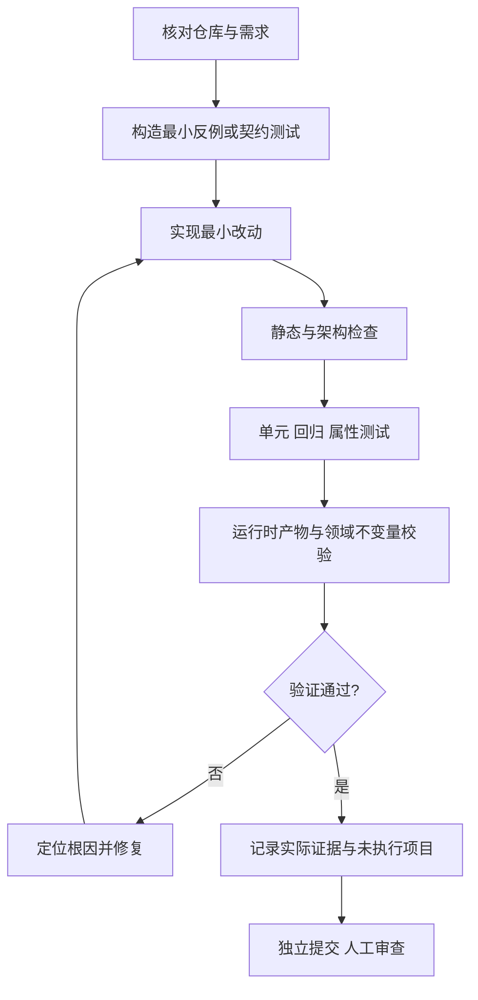

# Opt-Discovery Agent-ready Engineering 开发任务书

> 版本：1.0  |  目标：将 Agent 开发中的工程经验固化为可执行约束与可复核验证  
> 目标仓库：https://github.com/ilnnfover/opt-discovery  
> 适用对象：Codex、Claude Code 或其他具备仓库读写、测试执行能力的 Coding Agent  
> 执行方式：按任务依赖分批提交，每个任务形成独立可审查的增量；不是一次性重写项目。

## 0. Agent 执行指令

你是一名负责 opt-discovery 工程质量和验证基础设施建设的开发 Agent。请在用户已授权的本地仓库中完成实际实现，而不是仅编写方案或新增说明文档。

本任务借鉴 Lauren Tan 的《All Code Is Slop (Except Mine)》：优先通过代码架构、API、类型、测试、静态检查和运行时验证消除重复错误；仅将不可机械化的工程判断留给 AGENTS.md 和 skills。每次修复缺陷，都应尽可能留下可以防止该类缺陷再次发生的机制。

**总目标：后续 Agent 即使不熟悉 Ascend Profiler 的历史问题，也无法轻易产生违反数据契约的分析结果；若无法完成验证，系统必须显式暴露缺失与不确定性。**

本轮不以功能数量、测试数量或自动生成代码量作为完成标准，而以可运行的检查、真实反例、兼容性与验证证据为准。

---

## 1. 项目背景与实施范围

### 1.1 项目定位

opt-discovery 将 Ascend Profiler 导出数据转换为带证据的算子优化机会，目标环境为 Qwen3.5-35B-A3B、Ascend 910B、vLLM-Ascend。项目目前的主要能力包括解析、热点分析、瓶颈诊断、时间线、通信量、图覆盖率、采集契约、源码映射、Benchmark 对比和反馈。

它是优化机会发现与诊断工具，不是自动 Kernel 优化器。不能将诊断候选、潜在收益或工作负载级变化当成已经验证的算子优化成果。

已知四组负载（具体运行参数以仓库 YAML 和采集 manifest 为准）：

| Workload | 执行模式 | 输入→输出 token |
|---|---|---|
| prefill-eager | Eager | 1024→1 |
| decode-eager | Eager | 1→64 |
| prefill-graph | Graph / FULL_AND_PIECEWISE | 1024→1 |
| decode-graph | Graph / FULL_AND_PIECEWISE | 1→64 |

### 1.2 实施基线

公开仓库 README 记录了 119 个测试（其中 15 个为需要真实数据的集成测试）、12 类实测数据约束、`validate` 与 `demo` 命令，以及现有三等级证据契约。公开 `pyproject.toml` 声明 Python >=3.10、开发依赖 pytest；README 的推荐运行环境为 Python 3.12。这些是任务编写时的观察，不是当前工作树的保证，也不是本次实际测试结果。

执行前记录真实 commit、分支、本地改动、Python 版本、依赖、测试执行结果、目录结构和可访问数据。若现有实现与本文有差异，以真实代码为准，保留本文目标并说明调整。不应机械新增已存在的设施。

### 1.3 范围与非目标

P0（必须完成或明确阻塞）：基线审计、统一检查入口、12 类历史问题回归、分析运行状态和比较闸门、Profiler 数据标准化收敛。

P1（在 P0 稳定后执行）：架构约束、领域检查、属性测试、真实数据回归、证据流转 API 与验证产物。

P2（选做，独立提交）：Feature Map、薄 AGENTS.md、可复用验证 skill、Agent 验证报告与合并策略。

本轮不要求实现 Critical Path Analyzer、新的 HBM 采集机制、完整 MSTX 接入、新硬件阈值、新 LLM 分析功能、Kernel 代码生成、多 Agent 编排、TLA+/Lean 证明或自动合并。现有 Discovery v2 功能计划继续保留，避免将工程质量建设变成无边界重构。

---

## 2. 强制领域不变量（适用于所有任务）

Agent 必须首先核对现有实现、约束和测试，并使以下不变量能够由 API、Schema、测试或 CI 执行。

| ID | 不变量 | 强制机制（建议） |
|---|---|---|
| INV-01 | 未采集值与实测零严格区分；不能将缺失值变为 0 | Metric 契约、负向测试 |
| INV-02 | measured / derived / declared / assumed 来源不可伪造或提升 | Schema 与来源校验 |
| INV-03 | 单位转换只在所属数据源的标准化边界进行，不能重复缩放 | 统一 Reader、来源适配测试 |
| INV-04 | 图模式记录缺失不等于算子未执行；记录数不能作为通信量守恒指标 | 对比契约、回归测试 |
| INV-05 | 采集质量差、rank 损坏、不可比等情况不得进入不受限制的结论生成 | 质量与比较闸门 |
| INV-06 | 时间线区间必须裁剪至有效分析窗口；并发区间覆盖使用并集 | 区间属性测试 |
| INV-07 | 不得以采集误差或虚假性能差异升级证据 | 证据状态机、负向测试 |
| INV-08 | 规则命中最高 probable；confirmed 需要现有契约要求的 kernel 与端到端双重验证 | 证据升级 API |
| INV-09 | 工作负载级 A/B 不足以将收益归因到单个算子 | feedback 契约测试 |
| INV-10 | 合成数据仅用于自测，不能冒充真实采集或实测优化验证 | 数据来源隔离 |
| INV-11 | 缺失字段、来源回退、阈值不充分必须有可机器读取的说明 | 诊断审计、manifest |
| INV-12 | 大规模导出事件处理维持流式、分片或有界内存设计，不能无意物化全部原始行 | 性能回归、架构检查 |

不变量不等于人为限制所有合法情况。例如真实零可以保留，流水时间占比可能大于 1，只有具有相应物理语义的覆盖率才应限制在 [0,1]。不得用普遍 clamp、默认值或宽泛 except 掩盖异常。

---

## 3. 任务分解与执行依赖

| 任务 | 优先级 | 依赖 | 核心交付 |
|---|---|---|---|
| AE-00 | P0 | 无 | 基线与差距审计 |
| AE-01 | P0 | AE-00 | 可复现开发检查、CI |
| AE-02 | P0 | AE-00、AE-01 | 历史错误回归套件 |
| AE-03 | P0 | AE-02 | strict 运行契约、分析 manifest |
| AE-04 | P0 | AE-02 | 统一数据标准化边界 |
| AE-05 | P1 | AE-04 | 架构依赖与领域 Lint |
| AE-06 | P1 | AE-02、AE-04 | 属性测试、真实数据回归 |
| AE-07 | P1 | AE-03、AE-05 | 证据流转 API 与验证契约 |
| AE-08 | P2 | AE-01 至 AE-07 | Feature Map、AGENTS.md、验证报告 |

依赖项必须通过相关检查后，才能合并下游任务。可以并行开发互不冲突的任务，但禁止多个 Agent 同时重构同一核心模块。优先完成 AE-00~AE-03，再进行 AE-04 的生产代码重构。

### AE-00：仓库基线与差距审计

**输入：** 当前工作树、README、plan.md、pyproject.toml、configs、现有 tests、CLI 与相关模块、本地环境配置。

**工作：**

1. 记录 `git rev-parse HEAD`、`git status --short`、Python 版本与依赖环境。不要覆盖用户未提交的工作。
2. 阅读现有 Schema、CSV/SQLite 解析、Timeline、对比契约、诊断规则、feedback、CLI 与真实数据测试；建立调用链和测试覆盖映射。
3. 执行 `python -m pytest -q`、`python -m opt_discovery.cli validate`、`python -m opt_discovery.cli demo`，按实际 CLI 帮助或配置使用临时输出目录，避免覆盖已有结果。
4. 逐条核对 INV-01~12 与 README 的 12 项数据约束：标记 enforced / partially_enforced / missing / blocked，给出文件、符号、测试节点和证据。
5. 检查真实数据路径是否可访问；缺失时不执行性能结论验证，记录阻塞原因。

**交付：** 推荐 `docs/engineering/baseline-audit.md`，包含基线 commit、执行日志摘要、已知缺陷、已有约束覆盖及后续计划。脚本/日志中的机器绝对路径、密钥、私有模型路径不得提交。

**验收：** 已执行与未执行分开；能定位现有实现而非仅摘录 README；后续任务有明确差距。现有测试失败时，记录基线失败并先解决阻塞 P0 的问题，不得修改测试来制造绿色基线。

### AE-01：建立统一检查入口与 CI

**目标：** 将每次 Agent 修改后的验证变成一致的命令与强制合并闸门。

**实施：**

- 在现有 `pyproject.toml` 的 dev 依赖中添加 Ruff、静态类型检查工具（mypy 或 pyright，选其一并说明原因）；Hypothesis 等后续依赖按需添加。统一配置而非维护多份冲突配置。
- 核对 Python >=3.10 与 README 的 3.12 区别；默认保留声明的兼容范围，CI 至少测试最低支持版本与项目主要版本；若要缩小范围必须单独提出兼容迁移。
- 采用 Makefile 或跨平台 Python 检查脚本，保持独立底层命令可执行。以下为建议统一入口：

```bash
make check        # 静态检查 + 架构/领域检查（对应任务完成后）+ CLI validate
make verify       # 普通测试 + 回归 + 属性测试（对应任务完成后）+ demo
make verify-real  # 指定真实数据集的集成检查；缺数据明确非零/blocked
```

- 建议在 `.github/workflows/ci.yml` 实现 PR/push 检查。公共 CI 默认 CPU-only、无 Ascend NPU、无真实数据、无 secret；使用普通测试和最小脱敏 fixture。真实回归独立受控执行，不在公开 runner 上访问私有数据。
- 初次启用 Ruff/type check 时先收敛新增和关键领域代码的错误，若历史债务确需临时基线，列明具体位置、原因、收敛任务；禁止全局忽略、`|| true` 或将失败标成通过。
- CI 失败应定位规则、文件、原因和推荐修复方式。新增检查本身应有正负用例（AE-05）。

**验收：** 全新 CPU 环境可按 README 安装开发依赖并运行 `make check` / `make verify`；引入已知 lint、类型、配置或测试错误时相应 CI job 非零退出。缺数据跳过不得在 `verify-real` 显示为 PASS。仓库保护设置若无权限配置，只提供管理员启用说明，不声称已强制。

### AE-02：将历史 Profiling 问题固化为回归测试

**目标：** 以 README 所记录的 12 类数据约束作为错误目录，一项一项验证现有覆盖。已有有效测试直接登记，不重复实现。

每个条目至少提供：历史错误 → 现有实现 → 最小 fixture → 独立预期 → 反例/故障注入 → 失败信息 → 相关不变量。fixture 必须经过脱敏，不能直接提交百万行原始数据。

| ID | README 已知问题 | 必须验证的结果 |
|---|---|---|
| R01 | `op_summary` 百万行分片 | 所有分片按自然序读取；分片与单文件的规范化聚合等价；不能漏读或重复读 |
| R02 | `op_statistic` 缺 HCCL | 不得将此来源视为完整通信时间，缺失能力要有明确标记 |
| R03 | 同一 OP Type 按 Core Type 拆行 | 按目标聚合维度保留正确总调用数、累计时间、加权平均；不能简单平均平均值 |
| R04 | 流水时间占比可 >1 | 合法跨实例/流水重叠保留并标注；不能一律 clamp 为 1 |
| R05 | 历史 decode rank1 无 CSV、SQLite 回填及 rank 不可合并 | 仅在来源支持时回填；标记来源；不把异常 rank 当可直接合并的可信观测 |
| R06 | MSTX 缺失 | 仅存在枚举表不代表已采集事件；同步指标缺失、host_silent 不作原因猜测 |
| R07 | Graph 算子集合收缩 | 未单独上报不意味着未执行/已删除；不得据此计算消除收益 |
| R08 | 通信 Task Duration 单位异常 | 针对已核实的来源/任务类型只缩放一次；110462688 ns = 110462.688 µs；非通信及其他来源遵循各自契约 |
| R09 | 33 列与 46 列导出差异 | 可选缺列不阻塞，有缺失标记；FLOPs 单位正确；未知列进入映射审计 |
| R10 | decode-eager rank1 长 kernel 时长截断 | 指定数据质量异常出现；不据此断言 rank 负载不均或等待；相关对比受限 |
| R11 | Task Duration 小于 aicore_time | 利用率分母遵循流水活跃时间语义；缺分母不伪造利用率 |
| R12 | epoch 到首个有效忙区间形成伪 gap | 不将 epoch 原点或不属于有效分析区间的时间算作设备空洞；区分明确实测窗口与回退窗口 |

补充重点测试：多线程 Host ACL 事件覆盖使用区间并集、`op_summary` 优先及 TASK fallback 告警、通信任务按真实身份去重、阈值样本门槛、留出验证不稳定时降级、对比契约不通过等。

**要求：** 对于已修复错误，用最小反例验证旧行为会被测试捕获（例如临时故障注入或隔离分支上的 mutation）；禁止故意在主分支引入错误。预期值应来自独立计算或人工核对，不得直接复用被测函数计算 expected。

**交付：** 建议 `tests/regression/`、`tests/fixtures/`、`docs/engineering/regression-matrix.md`；如当前测试组织更合适可复用，记录每条约束与测试节点的关系。

**验收：** R01~R12 均有可执行测试或明确标注无法复现的原因及替代验证；CPU 回归不依赖私有数据；至少每种已证实错误都有有效的负向测试。缺证据的约束不能假装已被真实验证。

### AE-03：强化 CLI / Pipeline 运行契约

**背景：** 当前 CLI 具有 `analyze`、`compare`、`check-runs` 等入口。需要核对分析异常捕获、return code、比较状态、产物生成的实际逻辑，避免 Agent 将“程序退出 0”或“JSON 存在”当作完整分析成功。

**设计：** 保留现有普通模式的可用性，新增自动化可用的 strict 模式或等价独立验证命令。先明确哪些步骤是必需、哪些是可选，不因一个可选 source-map 缺失而错误宣告核心分析失败。

建议状态契约：

| 状态 | 含义 | strict 退出约定（建议） |
|---|---|---|
| success | 所有选定必需步骤通过 | 0 |
| partial | 必需步骤未完成，但有部分可用产物 | 非零 |
| incomparable | 目标对比不满足契约 | 非零 |
| failed | 必需输入或执行失败 | 非零 |

具体退出码应与现有 CLI 兼容并文档化。某些输入质量 degraded 可仍产出诊断，但受影响的结论必须被限制，不能将 degraded 无条件等同于 failed 或 success。比较必须依据 contract gate，不可比时可保存审计和描述性数据，但不得输出有效速度差或因果判断。

**建议接口（待核对实际参数）：**

```bash
python -m opt_discovery.cli analyze ... --strict
python -m opt_discovery.cli compare ... --strict
```

新增 `run_manifest.json`（优先复用现有运行元数据结构，避免与采集 `collection_manifest.json` 混淆）：

```json
{
  "schema_version": "1.0",
  "run_id": "example-only",
  "status": "partial",
  "is_synthetic": false,
  "strict": true,
  "stages": [
    {"name": "parse", "required": true, "status": "passed", "artifacts": []},
    {"name": "timeline", "required": true, "status": "failed", "reason_code": "missing_required_input", "artifacts": []}
  ],
  "quality_flags": [],
  "comparison_status": "not_requested"
}
```

这是目标示意，不是现有接口。完整设计还应记录 workload、输入/配置标识与哈希（可用时）、分析版本、结果路径、错误代码、必要证据、警告及运行时信息；避免在 manifest 中泄露绝对路径或秘密。未执行步骤使用 skipped/blocked/not_requested 等明确状态，不能混同失败和通过。防止复用输出目录时残留旧产物冒充本次输出：独立 run ID、产物清单或原子发布任选合理实现。

**验收：** 正常、缺输入、子步骤异常、不可比、可选步骤缺失、旧输出残留六类端到端 CLI 测试均符合契约；strict 不可比或必需步骤失败时退出非零；普通模式兼容性及产物 schema 变化有记录。

### AE-04：统一 Profiler 数据标准化与访问边界

**背景：** 公开源码显示 `parsers/csv_mapping.py` 定义通信时长缩放，`analyzer/timeline.py` 复用常量；前者依赖 `analyzer.window.Window`，后者依赖解析模块。直接禁止所有跨层依赖会误伤现有代码，需要先收敛底层类型和共享边界。

**目标：** 让新增 Analyzer 复用标准化事件与指标，而不是再次解释原始 Profiler 字段；保留大规模数据处理能力。

**实施步骤：**

1. 绘制现有 `op_summary`、`op_statistic`、SQLite、Host 事件、通信记录、graph coverage 的实际读取路径。识别可以共享的逻辑与不可共享的源特有语义。
2. 将通用 Window / Interval 等低层概念按实际依赖迁移或提取到稳定公共模块，保留必要兼容导入。
3. 首先收敛 `op_summary` 逐实例事件路径：自然序分片、时间戳与单位、任务类型、来源信息、缺失标记和窗口裁剪。随后按需要适配其他数据源，不要假定所有表都具备相同字段。
4. 保留 `op_statistic` 聚合行与实例行区别；将 TASK fallback、Host ACL 或通信字节等建模为独立适配器/事件类型，不将聚合行伪装为 kernel 实例。
5. 修改已存在消费者使用共享 Reader，删除重复路径；如果必须保留回退，保留显式原因和相应测试。不要引入同时维护的两套正式实现。

示意 API（名称、类型和具体结构允许依真实代码调整）：

```python
@dataclass(frozen=True)
class KernelEvent:
    operator: str
    rank: int
    stream_id: int | None
    start_us: float
    duration_us: float
    task_type: TaskType
    source: SourceReference


def iter_kernel_events(
    export: ProfilerExport,
    window: Window,
) -> Iterator[KernelEvent]:
    ...
```

必要字段缺失时，应按源契约拒绝、标记或选择显式 fallback，不能为满足类型而编造 rank、stream、时间戳。`source` 需足以定位输入来源；保留原始时钟域语义，避免 epoch 浮点精度损失和重复单位换算。若真实 Reader 的窗口筛选和区间裁剪具有不同语义，分别建模并测试。

**性能约束：** 对原始行保持惰性/流式；采用可重复的放大 fixture 或真实数据检查时间与峰值内存。先记录基线、定义同环境和容许噪声，再比较重构前后结果。不能仅用合成数据声称 NPU 性能提升。若为时间线排序必须保存区间，明确内存复杂度与适用规模。

**验收：** 两个以上实际消费者复用标准化接口；R01、R03、R08、R09、R10、R12 等测试不回退；相同输入的关键语义输出保持一致，差异必须有缺陷修复解释及独立预期；不引入无界原始记录列表。

### AE-05：架构依赖与领域 Lint

**目标：** 把 Agent 容易重复违反的规则变为确定性检查，而非不断扩充文字约定。

采用 import-linter 或自定义 AST/依赖检查器，选择维护成本最低且能可靠检查现有代码的方式。先由 AE-00/AE-04 的实际依赖图确定约束，再启用阻塞检查。优先约束明确、可识别、低误报的行为。

| 约束 | 建议执行方式 |
|---|---|
| 核心 Schema/领域类型不依赖 CLI、report 或 discovery | import 依赖检查 |
| diagnosis 不直接解析 raw Profiler 文件 | 依赖/API 边界检查 |
| report 不负责修改证据和重新诊断 | 依赖约束 + 契约测试 |
| CLI 只编排，不复制指标计算与证据规则 | 公共 API + 定向检查 |
| 原始单位转换集中在已授权适配器 | AST/文件边界检查 + 契约测试 |
| 缺失性能指标不可被静默替换为 0 | Metric API + 定向 AST 检查 |
| 证据升级仅经验证 API | 类型/封装 + 所有写入路径测试 |
| 异常回退必须可审计 | 负向测试 + 定向检查 |

建议领域检查编号 OD001（缺失指标）、OD002（重复单位转换）、OD003（原始数据访问）、OD004（绕过证据升级）、OD005（隐式失败吞没）、OD006（机器路径硬编码）、OD007（未登记阈值来源）。不要求为了凑数量强行实现无法准确检测的 AST 规则。无法静态判定的规则优先用 API、运行时验证及测试实现。

禁止用全局正则禁止所有 `or 0`、数字常量、`except` 或 CSV import 等合法语法。测试 fixture、展示默认值、合法适配器等应按语义划定范围。例外必须有明确理由、最小范围及回归覆盖。

**交付：** 可执行检查器、配置、允许/禁止样例测试、接入 `make check`，报错给出规则编号、文件位置及正确公共 API。

**验收：** 典型错误示例使检查确定性失败；合法示例通过；不靠全局 ignore 规避历史代码。新增特定违规路径能够被拦截，而不仅检查文档是否存在。

### AE-06：属性测试与真实数据回归体系

**属性测试：** 引入 Hypothesis，优先针对可独立计算的核心数学逻辑。

| 模块 | 属性/反例 |
|---|---|
| 区间并集 | 幂等、排列不变、覆盖窗口内、重复区间不重复累加 |
| 多 rank timeline | 相同可用 rank 集合及窗口下 `busy_all <= busy_any`；分别满足有效域约束 |
| 窗口 | 对同一有效窗口、同一覆盖定义，busy + idle = window；空窗口/无有效区间有明确语义 |
| Parser | 对合法输入聚合结果与行序/分片无关；浮点采用明确容差 |
| Metric | 缺失与实测零保持区别；derived 不可冒充 measured |
| Diagnosis | 缺必要证据时相应规则 blocked 或按已定义契约降级；不误升等级 |
| Comparison | 任一硬性契约 fail 后不产生可用对比结论 |
| Evidence | 合成数据或不满足归因要求的实验不得升级真实机会 |

属性测试要包含空输入、重叠、包含、边界相接、非法 interval、极小/极大值、缺失列、重复事件等。不要把浮点任意误差当作严格等式；不要简单复制生产算法作为 oracle。为 CI 设置稳定的 profile 和合理示例数，记录失败 seed 或可复现最小反例。

**真实回归：** 使用用户已授权的四组统一补采数据。通过环境变量配置根目录，核对数据集 ID、采集契约、轮次与输入来源。现有 README 推荐 rounds 0–2；不可混合历史不同采集口径的数据。未经授权不重新采集或占用 NPU。

分类维护三种验证：CPU 最小 fixture（必跑）、synthetic 全流程（必跑）、真实数据回归（有数据时运行且单独报告）。真实回归重点验证关键契约与可信结论，不要求每一个时间值逐字相同。对固定导出可采用独立复核的 golden snapshot，对新采集则使用物理/统计不变量与预先声明的容差。不要把当前程序输出盲目冻结为真值。

真实回归重点：rank 时长异常不得解释为真实不均；通信记录发生合并时不能把记录数差异解释为通信量减少；图覆盖率区分时间与任务数量；Host ACL 覆盖使用并集；缺 MSTX/HBM 实测时保持证据限制；采集参数不匹配时比较受阻。

**交付：** 属性测试、真实数据测试/manifest、独立核对的关键指标清单、验证执行脚本、回归报告。

**验收：** `make verify` 在无 NPU 环境运行；`make verify-real` 在无数据时明确 blocked 且非零退出、有数据时真实执行；如真实结果变化，要列出具体差异、原因和是否影响已有结论。禁止自动更新 golden 掩盖回归。

### AE-07：证据升级与实验反馈契约

**目标：** 分离机会生命周期、证据可信度、实验范围和来源，确保任何调用路径都不能绕过证据校验。

保留当前公开语义：`hypothesis`、`probable`、`confirmed`；规则最高 probable；单算子归因实验可按已实现契约升一级但不超过 probable；工作负载级 A/B 不自动提升算子级证据；confirmed 必须具有 kernel 与端到端双重验证。若将 Model 和 Serving 分为更细粒度的未来硬门槛，需先独立提出 schema 和兼容迁移，不在本次偷偷改变语义。

先检查现有 `schemas/opportunity.py`、`discovery/generator.py`、`experiment/feedback.py`、JSON 读写与诊断附加路径。设计统一升级入口，优先复用已有类型：

```python
def promote_evidence(
    opportunity: Opportunity,
    validation: ValidationBundle,
) -> Opportunity:
    ...
```

建议 `ValidationBundle` 最少能表达：实验范围（kernel/operator/model/serving/workload 等，采用现有枚举或扩展）、被测变更 ID、baseline/candidate 标识、输入或 workload、可比性、正确性结果、性能结果、样本与不确定性、来源、artifact reference。缺项时只能输出 blocked/保持等级，而非默默补齐数据。

证据升级需检查实验确实关联该机会、比较对象可比、正确性通过、实验覆盖范围满足级别、来源不是不适用的 synthetic，且支持实际性能结论。统计方法与判定阈值沿用已明确的现有策略，若需变更应单独评审，不能把“5% 阈值”自动解释为统计显著性。

生命周期状态（如 discovered/validating/accepted/rejected/blocked，以现有状态为准）独立于 evidence_level。accepted 不必然 confirmed；实验失败或无显著差异不等于优化一定无效。支持在新证据表明旧结论失效时显式撤回/降级，保留记录。

**必须测试：**

| 输入情形 | 预期 |
|---|---|
| 普通诊断规则命中 | 至多 probable |
| workload 级 A/B 更快但没有算子归因 | 不升级算子证据 |
| 单算子实验满足现有契约 | 最高 probable |
| 仅 kernel 或仅端到端验证 | 不得 confirmed |
| kernel + 端到端有效关联验证且满足约定的正确性与性能条件 | 可 confirmed |
| 实验不可比、样本不足、来源为 synthetic、缺失关键证据 | 拒绝相应升级，说明原因 |
| 不合法的 confirmed JSON/直接构造尝试 | 可信读取/消费边界拒绝或标为不可信，不可用于结论 |

**交付：** 统一 API、Schema/兼容适配、迁移说明、审计记录、负向测试。必要时保留历史数据的可读性，但不把历史无验证结论自动当作已确认。对 Python 不能绝对禁止内部对象构造这一事实，使用公开 API、验证型读取边界与 CI 多层保护。

**验收：** 所有生产级升级路径通过同一契约；CLI feedback 与直接调用、序列化后重新读取均验证；现有真实数据没有新的实验时，不凭空增加 confirmed。若当前有历史 confirmed 记录，则检查实际证据而不机械清零。

### AE-08：Agent 开发入口、Feature Map 与验证产物

**目标：** 让 Agent 不必依赖长规则文档或重复探索即可完成一次可验证的任务。

1. 新建简明 `docs/feature-map.md`（可选机器可读映射），按用户目标映射实际 CLI、模块、输入、输出、测试节点、必要环境和验收产物。覆盖解析、Timeline、热点、诊断、对比、通信、Graph、源码映射、反馈、标定。不要记录不存在的命令或测试。
2. 添加薄 `AGENTS.md`：项目目标、导航、任务流程、必须执行的真实检查、领域原则、安全边界、失败汇报。所有精确规则引用可运行机制，不复制长文档。建议控制在约 1–2 页。
3. 如开发工具支持 skills，建立一个 `verify-opt-discovery` 验证 skill，指导如何选择 check/verify/verify-real、如何审阅分析产物、如何处理 blocked。skill 不替代脚本，不将尚未实现的工具写成已存在。
4. 提供机器可读验证摘要及 PR 模板。区分 PASS / FAIL / SKIPPED / BLOCKED / NOT_RUN，保留命令、退出码和关键产物。对改变分析语义的 PR 自动报告关键 JSON/CSV、quality flags、证据级别、比较状态变化。
5. CI 和测试不能替代高风险人审。Schema、单位、阈值、证据升级、采集契约、性能结论及 CI 自身变更必须由人审核后合并。本轮不启用自动合并。

**验收：** 让一个不熟悉项目的 Agent 根据 Feature Map 完成一次低风险修改，运行对应检查并产出完整验证摘要；缺真实数据时明确报告 NOT_RUN/BLOCKED；无效且可检测的代码修改被阻止。不能仅靠撰写 AGENTS.md 宣称达到 Agent-ready。

---

## 4. 建议文件组织（不是强制迁移清单）

优先沿用已有 `opt_discovery/schemas`、`collectors`、`parsers`、`analyzer`、`diagnosis`、`discovery`、`source_analysis`、`experiment`、`report` 结构。以下仅表示建议增量，新增文件前检查同名和相近职责实现。

```text
opt-discovery/
├── AGENTS.md                           # AE-08
├── Makefile                            # AE-01；或统一 Python 检查入口
├── pyproject.toml                      # 保留原依赖并增加开发工具配置
├── .github/
│   ├── workflows/ci.yml                # AE-01
│   └── pull_request_template.md        # AE-08
├── opt_discovery/
│   ├── schemas/                        # 复用；运行/证据契约按需增加
│   ├── parsers/                        # 统一源适配器、标准化 Reader
│   ├── analyzer/                       # 消费标准化数据
│   ├── experiment/                     # 实验反馈与证据验证
│   └── cli.py                          # 入口与状态传播
├── scripts/
│   └── check_architecture.py           # AE-05；若用现成工具则可省略
├── tests/
│   ├── regression/                     # 历史错误
│   ├── contracts/                      # Schema/CLI/证据/检查器
│   ├── properties/                     # Hypothesis
│   ├── fixtures/                       # 最小脱敏样本
│   └── integration/                    # 复用已有真实数据测试
└── docs/
    ├── feature-map.md
    └── engineering/
        ├── baseline-audit.md
        ├── regression-matrix.md
        └── verification.md
```

禁止为了匹配此目录树而移动全部现有文件。若新增公共类型或 pipeline 层，需说明依赖关系、迁移范围与兼容性，先小规模迁移后删除旧实现。

---

## 5. 开发流程与质量闸门

每个任务使用如下闭环：



### 5.1 变更原则

- 先复用现有模型、函数、检查器和 fixture；只有当职责确实独立时新增抽象。
- 每个 PR 聚焦单一任务，测试与变更一起提交；格式化的大规模变动与语义重构分离。
- 修复错误时首先构造可失败的回归测试；当缺陷类型可以由 API 或架构消灭时再加相应机制。
- 不新增不存在的 profiler 字段，不假定所有版本的源数据格式一致，不用虚构的 benchmark 或硬件指标补齐证据。
- 不得删除测试、放宽已有断言、无理由扩大 ignore/skip/xfail、硬编码预期、修改 baseline 比较对象、伪造输出或只修改文档来绕过验收。
- 对真实数据、NPU 或外部源码依赖不足的情况，完整实现能在当前环境执行的部分，列出阻塞输入、复现方式和恢复条件，不宣称通过。
- 不主动修改用户其他仓库、生产环境、模型文件、采集原始数据、Git 远端或密钥。只在已授权环境执行；不要未经同意启动耗费 NPU 资源的采集任务或自动推送/合并。

### 5.2 测试层次与合并策略

| 层 | 检查 | 默认要求 |
|---|---|---|
| 静态 | Ruff、类型检查、依赖规则、领域 Lint | 必须通过 |
| 配置 | CLI validate、规则/阈值/Workload/列映射契约 | 必须通过 |
| 功能 | 单元、契约、回归、属性测试 | 必须通过 |
| 运行时 | synthetic demo、CLI 退出语义、Schema 与分析产物 | 必须通过 |
| 真实数据 | 四组导出数据回归、核心结果差异分析 | 改变解析/分析语义时要求执行；缺数据则标阻塞，不视作完成真实回归 |
| NPU 实验 | 新采集、kernel/model/serving 性能验证 | 仅涉及实际性能/证据升级且已授权时执行 |

普通 CPU-only PR 可在真实数据不可用时通过前四层，但不能声称已验证真实数据行为；影响领域语义的高风险 PR 应在真实回归完成前保持待审/待验证，除非用户明确批准有记录的风险例外。

### 5.3 每个任务的 Definition of Done

- 有具体实现且满足该任务的输入输出、边界及验收要求。
- 相关失败模式由确定性检查捕获，并能提供可复现证据。
- 基线行为未发生无解释回退；兼容性和行为变化有记录。
- 已运行必要检查并报告真实结果；未执行项目和原因单列。
- 不减少原有验证强度，不提高虚假证据等级，不新增未经验证的性能承诺。
- 形成可审查的独立变更，包含必要文档和测试。

---

## 6. Agent 最终交付报告模板

每完成一个任务，按照以下模板交付，不要只给出“已完成”或代码摘要。禁止预填 PASS。

```markdown
# AE-XX 实施报告

## 1. 基线与目标
- 基线 commit / 分支：
- 工作树状态：
- 本次任务与非目标：

## 2. 实际改动
| 文件/符号 | 修改内容 | 修改原因 |
|---|---|---|

## 3. 不变量与反例
| 不变量/回归 ID | 测试节点/检查规则 | 独立预期 | 实际结果 |
|---|---|---|---|

## 4. 验证执行记录
| 检查 | 实际命令 | 退出码 | PASS/FAIL/SKIPPED/BLOCKED/NOT_RUN | 产物或日志 |
|---|---|---|---|---|

## 5. 行为差异与风险
- Schema / CLI 兼容性：
- 分析结果变化及原因：
- 证据等级变化及支撑：
- 运行时与内存基线（如适用）：
- 是否使用真实数据 / NPU：

## 6. 阻塞与剩余问题
- 缺少的输入、环境或证据：
- 影响哪些结论或验收项：
- 解除阻塞的具体命令与条件：

## 7. 结论
- 已完成的验收项：
- 未完成的验收项：
- 建议下一任务：
```

---

## 7. 总体验收与成功判据

项目达到本轮 Agent-ready 目标的最低门槛：

| 验收项 | 判定标准 |
|---|---|
| 可重现开发环境 | CPU-only 新环境可以执行统一检查入口 |
| 历史缺陷保护 | README 12 类问题全部有覆盖映射；缺项明确阻塞且不得宣称已保护 |
| 失败可见性 | strict 分析/比较不将失败或不可比作为成功 |
| 统一数据边界 | 核心实例事件标准化不再由各消费者重复实现 |
| 架构护栏 | 至少核心依赖/原始访问/关键领域约束有可执行正负检查 |
| 属性验证 | 时间线、解析和证据至少有实质性属性/契约覆盖 |
| 实际数据 | 真实回归独立运行与报告，明确采集质量限制 |
| 可信证据 | 无合法验证不能提升证据；工作负载级变化不能冒充算子收益 |
| Agent 可操作性 | 命令、Feature Map、验证报告能支持独立完成任务（AE-08 后） |

量化跟踪建议：按真实数据记录历史问题覆盖率（12 项）、必需检查通过情况、领域反例拒绝情况、未解释分析差异、未经验证的证据升级数、检查耗时和峰值内存。无真实实验时不要求 confirmed 数增加。不要使用代码行数或简单测试数量作为项目质量指标。

**最终判定：** 新增一个 Analyzer 或优化机会规则时，正确的数据访问、缺失处理、证据等级和输出状态应由系统约束；错误写法要么无法通过公共 API/验证边界，要么被检查与测试捕获。不能仅靠 Agent 阅读长文档来维持正确性。

---

## 8. 首次运行指令（直接交给开发 Agent）

阅读本任务书后，先执行 AE-00，然后完成 AE-01；核对并新增 AE-02 的回归覆盖。在完成这些基础保护前，禁止大规模重写 Parser、Timeline 或证据 Schema。

每个任务先审计已有实现、提供最小设计和反例，再实际修改代码并执行检查。若存在阻塞，先完成不依赖该阻塞的增量并明确记录；不要跳过测试直接宣布结果。优先交付可运行的 AE-00~AE-02，而非一次性生成 AE-00~AE-08 的空壳。后续按第 3 节依赖继续执行。

## 9. 参考依据

- Lauren Tan, *All Code Is Slop (Except Mine)*：用户提供的演讲整理全文，重点是倒金字塔、确定性检查、验证与先内层后外层的开发闭环。原视频：https://www.youtube.com/watch?v=ZZ19zhYnDKY
- opt-discovery 仓库：https://github.com/ilnnfover/opt-discovery
- 当前公开 README：https://github.com/ilnnfover/opt-discovery/blob/main/README.md
- 项目配置：https://github.com/ilnnfover/opt-discovery/blob/main/pyproject.toml
- CLI、解析与时间线公开实现：`opt_discovery/cli.py`、`opt_discovery/parsers/csv_mapping.py`、`opt_discovery/analyzer/timeline.py`。

本文是开发任务书，不是已完成实现或测试报告。执行时以当前工作树的实际状态与用户授权为准。
